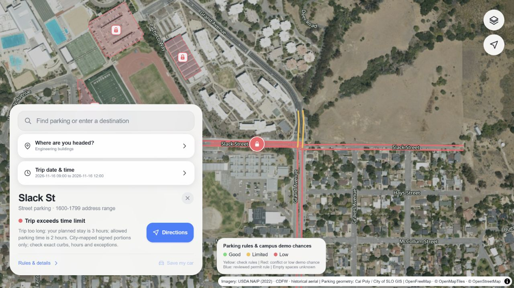
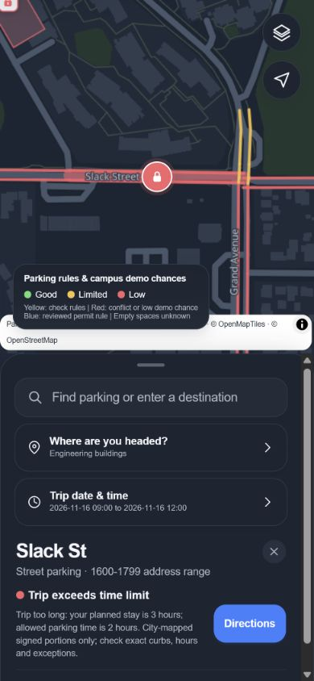

# City street rule verification

November 15, 2026. All 64 Node tests and source syntax checks pass. Research and full section coverage: [City street rules](../../docs/research/city-street-rules-2026-11-15.md).

Browser checks on the local build:

- Slack 1600-1799, Monday November 16 09:00-12:00: red, three hours planned versus two allowed; saving a car is disabled for this known time conflict.
- Murray 800-899 during the same trip: red missing City permit warning with weekday 8 AM-5 PM hours. Selecting the separate Murray permit changes to yellow check-curb status, without claiming eligibility. Selection survives reload.
- Streets-only shortlist for the three-hour trip and no City permit: Abbott's signed ten-hour zone is the sole area to inspect; two-hour and permit-conflict streets are excluded.
- Selected Slack remains red with the same explanation across Satellite and Dark. Existing overlay-restoration test also passes.
- Phone 390x844 has no horizontal overflow; the warning and trip controls remain readable and the sheet scrolls. No browser errors were captured.

City centerlines/address ranges and nearby zone evidence do not establish exact curb permissions. Timed-zone enforcement hours, shorter signs, special spaces and temporary restrictions require sign checks. No actual vacancies are inferred. The general City 72-hour ceiling is not permission or a street suggestion. These checks cover the app's 42 mapped street sections, not all City streets.
