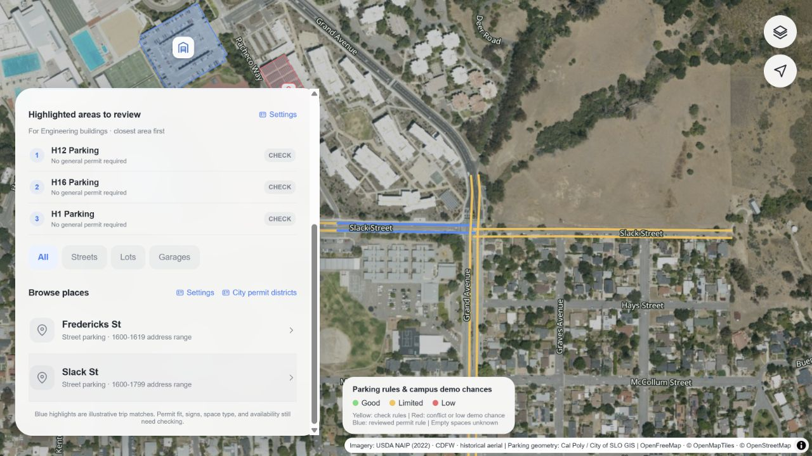

# Verity(1): quick smoke test

Date: November 15, 2026. Branch: `Verity(1)`. Baseline: origin/main `e3e9b08`.

Reduced scope requested by the user: a short local smoke test rather than a full end-to-end audit. Current public Site version 4 uses app source e18066c; baseline e3e9b08 adds only deployment documentation/evidence, so app assets match that publication. Tested at http://127.0.0.1:5174.

## Finding and fix

Searching `1600` returned no results even though street cards displayed matching address ranges. Include the displayed block label in searchable text. Browser retest returns Fredericks 1600-1619 and Slack 1600-1799, and selecting Slack opens the correct section. This is text matching of source address-range labels, not address geocoding or curb verification.

## Checks

- Search by street name, empty-result state and address-range fix: pass.
- Reversed arrival/departure: rejected with Leave time must be after arrival time; correcting it succeeds.
- Three-hour Monday Slack trip: red with two-hour maximum and correct explanation.
- Directions link: correct Google Maps destination coordinates present; external navigation was not exercised.
- Switch Dark to Satellite: selected Slack and rule details retained; map bands rendered.
- City permit toggle: Murray selection updates its pressed state.
- Phone viewport 390x844: no horizontal overflow, readable scrollable place sheet. Viewport reset afterward.
- No captured browser console errors in this local smoke test.
- All source syntax checks and all 64 Node tests pass.

Interactions completed without an observed stuck state. No load benchmark or universal speed claim is made. Browser automation needed one fresh-state retry immediately after reload; the page remained usable.

Not covered in this shortened pass: full session/reminder lifecycle, every permit/district, all map providers/styles, walkthrough, assistant, reports, real-device background notifications, live occupancy or external services. Existing unimplemented features remain unconnected.

Publication scope: commit and push this branch only. No main merge or production deployment in this Verity run.
